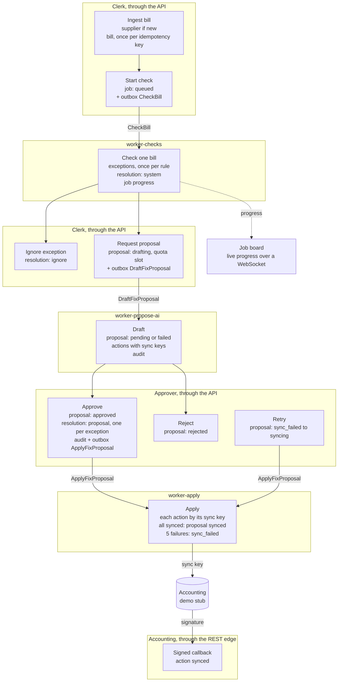

# Bill Exception AI Agent

**A bill goes in; exceptions come out; an agent drafts the fix; nothing is paid until someone approves.**

A multi-tenant console for a small accounts team. A clerk ingests supplier bills. Background
workers check them and raise exceptions. An agent drafts a fix plan on request. A second person
approves or rejects it. Only then does a worker send the approved actions to accounting.

| Part | Stack |
| --- | --- |
| Console | React 18, Vite, Apollo Client, MUI |
| API | Django 5.1, Graphene, Django Channels |
| Workers | Celery 5.4 on RabbitMQ, one image with one queue per container |
| Data | PostgreSQL 16 with row-level security, Redis 7 |
| Identity | OIDC with JWT. Dev and CI use `mock-oauth2-server` |
| Model | Stub by default. OpenAI when `LLM_PROVIDER=openai` |

## Run it

Needs Docker and GNU Make.

```
make demo
```

It starts the stack, runs the migrations and seeds two tenants. A second run changes nothing.

| URL | What |
| --- | --- |
| http://localhost:3000 | The console |
| http://localhost:8000/readyz | API readiness: Postgres, Redis and RabbitMQ |
| http://localhost:15672 | RabbitMQ management (`payables` / `payables`) |

Set `WEB_PORT`, `API_PORT`, `OIDC_PORT` or `RABBITMQ_UI_PORT` when a port is taken.

The sign-in page shows one button for each demo user:

| User | Role | Tenant | What to try |
| --- | --- | --- | --- |
| C1 | clerk | Acme Foods | Open the inbox. It holds one exception of each rule. Request a fix proposal. |
| A1 | approver | Acme Foods | Approve or reject the proposal. Watch it sync. |
| A2 | approver | Acme Foods | A second approver for the same tenant. |
| C9 | clerk | Beta Bakery | A second tenant. It sees only its own two exceptions. |

The seeded Acme Foods bills raise one exception per rule:

| Rule | Bill | Why |
| --- | --- | --- |
| `duplicate` | Fresh Farms `inv 001` | The same invoice number as `INV-001`, after normalisation. |
| `possible_duplicate` | Fresh Farms `INV-002` | The same supplier and amount, 4 days apart. |
| `po_mismatch` | Northern Packaging `NP-7001` | `PO-200` is for 450.00 GBP. The bill is for 520.00 GBP. |
| `missing_vat` | City Cleaning `CC-300` | No VAT amount. |
| `missing_receipt` | Riverside Logistics `RL-88` | No receipt. |

The accounting side is a demo stub. The "Accounting (stub)" page lists each action it received,
with its sync key. `ACCOUNTING_STUB_MODE=ok|fail|callback` sets its answer.

### The real model

The stub drafts a fixed plan. To draft with OpenAI, set both variables before `make demo`:

```
export LLM_PROVIDER=openai
export OPENAI_API_KEY=sk-...
```

`LLM_MODEL` pins the model id. Only the `worker-propose-ai` container gets the key. The API, the
other workers and the console never hold it.

### A real identity provider

The API reads two claims from the access token:

| Claim | Value |
| --- | --- |
| `tenant_id` | The tenant UUID. The API never takes the tenant from a request argument. |
| `role` | `clerk` or `approver` |

Map these claims in the provider. Then set `OIDC_ISSUER`, `OIDC_JWKS_URL` and `OIDC_AUDIENCE` on
the API, and `VITE_OIDC_AUTHORITY` and `VITE_OIDC_CLIENT_ID` on the console build.

## How it works

Each box is one transaction. Each arrow between workers is a command in an outbox table, which a
relay publishes to RabbitMQ. A worker can get a message twice, so each handler is idempotent.



The agent can only draft. Its tools are an allowlist of reads and draft actions. It has at most
8 tool calls and 60 seconds. Bill text goes to the model as untrusted data, with no bank details
and no other tenant's rows.

## The hard part: one resolution per exception

Two approvers can approve two proposals that hold the same exception, at the same time. If both
win, accounting gets two credit notes for one duplicate bill. An approve can also race an ignore,
or a re-check that resolves the exception.

The guard is in the database. Each approve inserts one `resolution` row per exception, in the
same transaction that marks the proposal approved. `resolution.exception_id` is the primary key,
so the second insert fails. That approve rolls back, and its proposal becomes `stale`.

The tests run the two transactions on two connections, with a barrier before the write. Each one
fails when the primary key is removed:

```
apps/api/tests/test_approval_concurrency.py    approve and approve, approve and ignore, approve and re-check
apps/api/tests/test_resolution_concurrency.py  ignore and ignore, ignore and re-check
```

## Tests

One command runs every level against the Compose stack. CI runs the same command.

```
make test-all
```

It starts the stack, migrates, seeds the demo, then runs pytest, the import contract, the schema
check, the console lint, types and unit tests, and the Playwright specs. It stops at the first
failure and keeps the service logs and the Playwright traces in `test-results/`.

With the stack up, each level runs alone:

| Level | Command |
| --- | --- |
| API: unit, integration and concurrency | `make test-api` (`ARGS="tests/test_us12_approve_fix_proposal.py"` for one file) |
| Domain import contract | `docker compose exec api uv run lint-imports` |
| Console unit | `npm --prefix web run test` |
| Browser, each screen and the full path | `npx --prefix web playwright test` |
| One live draft with the real model | `make test-openai`, skipped with no `OPENAI_API_KEY` |
| Start-check time with 500 bills, report only | `make bench` |
| Infra sketch | `make infra-validate` |

`web/e2e/full-path.spec.ts` walks the whole product: ingest two bills with the same invoice
number, start a check, see the duplicate, request a proposal, approve it as a second user, see the
exception resolved and the action once in the accounting stub.

## Deploy shape

`infra/` is a Terraform sketch of an ECS Fargate deploy. CI validates it. It is not applied.

```
ALB -> web (nginx, console) -> api
    -> api (/callbacks/accounting/*)
ECS services: api, relay, worker-checks, worker-propose-ai, worker-apply, worker-reports, web
Data: RDS PostgreSQL, ElastiCache Redis, Amazon MQ for RabbitMQ
Secrets: Secrets Manager, each service reads only its own
Migrations: a one-off task before each deploy
```

## Out of scope for v1

- SAML sign-in.
- Sign-up, tenant and user management in the product.
- A real accounting adapter. Xero is the next adapter behind the same port.
- PO sync from accounting software.
- Bill ingest by supplier webhook.
- Changing a bill or a PO after ingest.
- Payment. The product never pays a bill.

The design records are in `docs/`: the brief, the domain model with its stories and invariants,
the decisions, and the plan.
