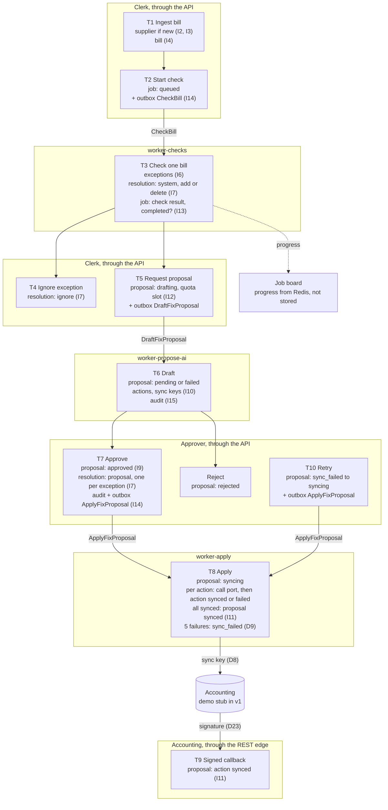

# Architecture

## Flow: one transaction per box

Each box is one transaction. It changes one aggregate, or only rows that a unique key guards. Each arrow between workers is a command in the outbox (D4, D45).

Derived on read, never stored: exception status, job failed count, money at risk (D38).

Races that the database stops:

| Race | Guard |
| --- | --- |
| Approve P1 and approve P2, both on E1 | Unique resolution per exception (I7) |
| Approve P1 and ignore E1 | Unique resolution per exception (I7) |
| Approve P1 and re-check that resolves E1 | Unique resolution per exception (I7) |
| A1 and A2 approve P1 | Conditional update `pending` to `approved` (I9) |
| Two callbacks for two actions of P1 | Row lock on P1 (I11) |
| Two workers finish the last two bills of J1 | Row lock on J1 (I13) |
| Two requests take quota slot 50 | Unique tenant, day, slot (I12) |
