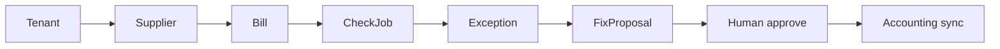
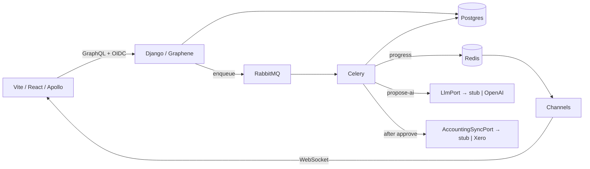

# Bill Exception AI Agent - Brief

## Use case

An SME accounts team must catch **bad bills before money leaves** the business.

Bills arrive from suppliers throughout the week. Some are duplicates. Some do not match a purchase order. Some miss VAT or a receipt. Paying them quietly is expensive. Hiring a full AP team is not realistic for a 5-50 person company.

When bills need checking, the platform must:

1. **Ingest** bills as durable facts for the tenant.
2. **Check** them asynchronously and raise exceptions.
3. **Propose** a fix via an AI agent when asked.
4. **Apply** only after a human approves, then sync to accounting software.

Checking is slow and bursty. The UI must stay live. The agent may draft a plan. It must never pay or sync on its own. One tenant must never see another tenant's bills.

### Domain (high level)



| Concept | Meaning |
|---|---|
| Tenant | SME company using the product |
| Supplier | Vendor that sends bills |
| Bill | Invoice / bill to review before pay |
| Check job | Async validation run over one bill or a batch |
| Exception | Problem found (duplicate, mismatch, missing data) |
| Fix proposal | Agent-drafted plan; not an apply |
| Accounting sync | Push approved action via an accounting port (adapters: stub, Xero, …) |

## Functional requirements

- Sign in with JWT and OIDC; every query is scoped to the current tenant.
- Register suppliers and ingest bills for that tenant only.
- Start a check job and return a job id immediately; work runs in the background.
- Show live job progress to the console (queued → running → completed | failed).
- Persist exceptions with type, severity, and status (`open` / `resolved` / `ignored`).
- Let a user ask the agent for a fix proposal on selected exceptions.
- Require human approve or reject before any apply / sync.
- On approve, enqueue an apply job that calls the accounting sync port (stub by default; Xero is one adapter).
- Expose a GraphQL API for the product UI and REST at the edges (webhooks, health, sync callbacks).
- Produce a simple tenant report of open exceptions and money at risk.

## Non-functional requirements

- Starting a check must not wait for the full validation run to finish.
- A failed accounting sync must not undo a committed approve decision; retry separately.
- Agent tool calls are allowlisted; secrets and other tenants' data never go to the model.
- Model provider credentials stay on the worker; the browser never calls the model.
- RequestFixProposal requires an authenticated user and is rate-limited and quota-capped per tenant (over limit returns 429).
- Bill and exception text is treated as untrusted input (prompt-injection aware).
- Messaging delivery for jobs is at-least-once; handlers are idempotent.
- Multi-tenant isolation: wrong tenant returns empty / 404, never another tenant's rows.
- Stack targets used in multi-tenant B2B SaaS practice: React (Vite / Node toolchain), Apollo, WebSockets, Django, Graphene, Postgres, Celery, Redis, RabbitMQ, JWT/OIDC, containers on AWS-shaped deploy.
- Auth MVP is OIDC + JWT. OAuth2 fits that path. SAML is out of MVP.
- AI supply chain: pin model id and dependency versions; never put provider keys in the repo or browser.

## Proposed architecture

We propose **one product backend** (Django + Graphene), **one React console** (Apollo + WebSockets), **Celery workers** for long work, **PostgreSQL** as the system of record, **Redis** for progress / cache, and **RabbitMQ** as the Celery broker.

Clients use GraphQL for product reads and commands. Long work is a command that enqueues a Celery task and returns at once. Workers publish progress events for the console. The agent writes only a `FixProposal`. Apply runs in a separate queue after approve.

```
React console (Apollo + WS)
  |  GraphQL / WS
  v
Django + Graphene API
  |  enqueue
  v
RabbitMQ
  |-- checks     → worker-checks
  |-- propose-ai → worker-propose-ai   (+ LlmPort)
  |-- apply      → worker-apply        (+ AccountingSyncPort)
  |-- reports    → worker-reports
  |
  +--> Redis (progress) → Channels → console
  +--> PostgreSQL (tenant-scoped data)
```

One queue, one worker process. Same Celery app code; different `-Q` and container. Trade-off: more containers and deploy units; gain: separate concurrency, timeouts, and failure isolation (same idea as one SQS queue → one Lambda).

| Piece | Responsibility |
|---|---|
| Web console | Exception inbox, live job board, approve / reject |
| Django API | Auth, tenants, GraphQL schema, command entry |
| Celery `checks` | Validate bills; write exceptions; emit progress |
| Celery `propose-ai` | Agentic tool loop via `LlmPort`; persist fix proposal |
| Celery `apply` | After approve, call `AccountingSyncPort` |
| Celery `reports` | Async summary / export when heavy |
| Postgres | Bills, exceptions, jobs, proposals, audit |
| Redis | Job progress keys for WS fan-out |
| RabbitMQ | Task broker |
| `LlmPort` | Port for model calls; adapters: stub (tests/CI), OpenAI |
| `AccountingSyncPort` | Port for post-approve sync; adapters: stub, Xero, … |

| Message / command | Kind | Meaning |
|---|---|---|
| `StartBillCheck` | Command | User intent: check these bills now |
| `BillCheckProgress` | Event | Fact: job step / % updated |
| `BillCheckCompleted` | Event | Fact: check finished; exceptions written |
| `RequestFixProposal` | Command | User intent: ask agent for a plan |
| `FixProposalReady` | Event | Fact: draft stored; waiting on human |
| `ApproveFixProposal` | Command | Human intent: apply this plan |
| `AccountingSyncRequested` | Event / task | Fact: apply job enqueued |

The agent may call only allowlisted tools (for example list exceptions, lookup bill, draft hold / credit / match actions). It cannot enqueue apply. Approve is a separate command with an audit row (who, when, proposal id).

## Why this architecture

| Need from the use case | Design choice |
|---|---|
| Check is slow; UI must not block | Return job id; Celery runs the check |
| Live progress for operators | Redis progress + WebSocket events |
| Product UI needs flexible reads | GraphQL (Graphene) + Apollo |
| Edges need webhooks and sync callbacks | REST beside GraphQL |
| AI must not move money | Proposal entity; apply only after approve |
| Swap model or accounting vendor without rewriting core | Ports: `LlmPort`, `AccountingSyncPort`; adapters at the edge |
| Tenant isolation | `tenant_id` on every row and query |
| Practice multi-tenant B2B SaaS stack on a safe domain | SME bills; async jobs, SSO, human-gated agent |
| Failed sync must not erase approve | Approve commits first; apply retries independently |
| Prompt injection / data leak risk | Allowlisted tools, redaction, audit of agent I/O |
| Isolate slow LLM work from checks / apply | One worker process per queue; more infra, cleaner ops |

Celery + RabbitMQ is chosen because checks, propose-ai runs, and applies are independent workloads with different timeouts and retries. A single request/response API cannot own that. Redis holds ephemeral progress so the API and WS layer do not poll Postgres for every percent tick. Splitting workers costs extra containers; it keeps propose-ai from starving checks.

## Implementation shape

One repository, deployable as containers: web, api, four queue workers, and supporting infra. Domain rules live in the Django app centre; GraphQL, Celery, and port adapters (LLM, accounting sync) sit at the edges. Worker containers share one image; each starts with a different `-Q`.

Docker Compose runs the full stack for development. The same images can target ECS-style deploy later without changing boundaries.

```
repo/
  docker-compose.yml
  docs/
    brief.md
  apps/
    api/                 # Django + Graphene
      ...
    worker/              # shared Celery app; entry differs by -Q
      ...
  web/                   # React + Apollo
    ...
  infra/                 # IaC sketches (optional)
```

| Runtime | Role |
|---|---|
| `web` | React console |
| `api` | Django GraphQL / REST / auth / WS gateway |
| `worker-checks` | Celery `-Q checks` |
| `worker-propose-ai` | Celery `-Q propose-ai` |
| `worker-apply` | Celery `-Q apply` |
| `worker-reports` | Celery `-Q reports` |
| `postgres` | System of record |
| `redis` | Progress and Celery result backend as needed |
| `rabbitmq` | Celery broker |

## Success criteria

- Starting a check returns immediately and does not wait for validation to finish.
- Job progress appears on the console without a full page refresh.
- A failed or stopped apply worker does not undo a committed approve.
- The agent can create a fix proposal and cannot apply or sync alone.
- Tenant A never receives Tenant B's bills or exceptions.
- End-to-end path works: ingest → check → exceptions → proposal → approve → sync stub.
- Docker Compose runs web, api, four queue workers, postgres, redis, rabbitmq locally.
- CI runs tests on push; infra sketch covers container deploy (ECS-shaped).
- README states the product law: a bill goes in; exceptions come out; an agent drafts the fix; nothing is paid until someone approves.

## Tech stack reference

Order follows the system path: console → API → data → auth → async work → ports at the edge.

| Tech | Proves | Docs |
|---|---|---|
| Node.js | Toolchain for the Vite console (JD frontend) | https://nodejs.org/docs/latest/api/ |
| Vite | SPA build for the console | https://vite.dev/guide/ |
| React | Product console UI | https://react.dev/ |
| Apollo Client | GraphQL client, cache, UI data flow | https://www.apollographql.com/docs/react/ |
| Django Channels | Real-time job progress to the console | https://channels.readthedocs.io/ |
| Django | Multi-tenant API and domain rules | https://docs.djangoproject.com/ |
| Graphene-Django | GraphQL API design on Django | https://docs.graphene-python.org/projects/django/en/latest/ |
| PostgreSQL | System of record, tenant-scoped data | https://www.postgresql.org/docs/ |
| OpenID Connect | SSO login, JWT for API access | https://openid.net/developers/how-connect-works/ |
| Celery | Long-running checks, propose-ai, apply jobs | https://docs.celeryq.dev/en/stable/ |
| Celery + Django | Workers wired into the Django app | https://docs.celeryq.dev/en/stable/django/first-steps-with-django.html |
| RabbitMQ | Task broker between API and workers | https://www.rabbitmq.com/docs |
| Celery + RabbitMQ | Celery configured on that broker | https://docs.celeryq.dev/en/stable/getting-started/backends-and-brokers/rabbitmq.html |
| Redis | Job progress without polling Postgres | https://redis.io/docs/ |
| OpenAI API | One `LlmPort` adapter for fix proposals | https://platform.openai.com/docs |
| Xero API | One `AccountingSyncPort` adapter (optional) | https://developer.xero.com/documentation/ |

Stub adapters (no external call): `LlmPort` stub for tests/CI; `AccountingSyncPort` stub for local demo.


